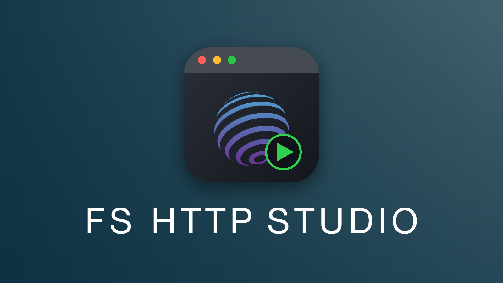
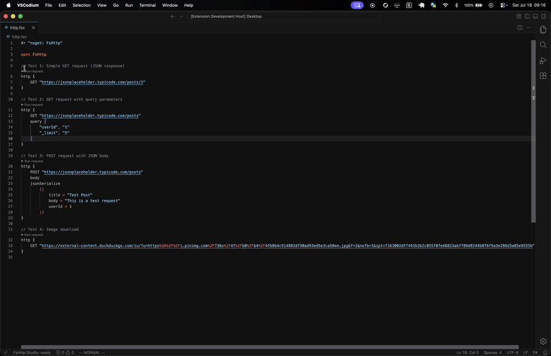
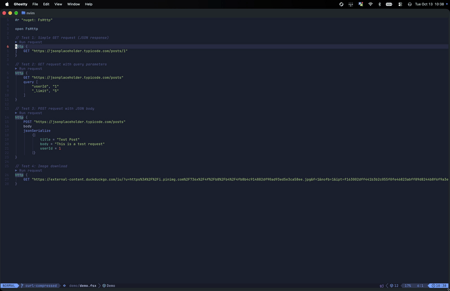

<p align="center">
  
</p>

# FsHttp.Studio

<p align="center">
  <a href="https://marketplace.visualstudio.com/items?itemName=twopoint.fshttp-studio"></a>
  <a href="https://github.com/tw0po1nt/FsHttp.Studio/actions/workflows/ci.yml"></a>
  <a href="./LICENSE"></a>
</p>

FsHttp.Studio runs a single [FsHttp](https://github.com/fsprojects/FsHttp) request from your F# script and **renders** the response (images, JSON, HTML) instead of flattening it to text.

## Why

[FsHttp](https://github.com/fsprojects/FsHttp) is a code-first replacement for Postman and `.http` files, and it uses FSI as the driver. But FSI can only **print**. It flattens every response into a string:

- an image becomes a byte dump,
- a JSON payload becomes one dense line you cannot browse,
- an HTML page becomes escaped source.

*Seeing* the response is the part that makes a request tool worth using, and it is the exact part FSI cannot do. FSI's printer also destroys the response body, because that body is read-once by default. Reading the bytes yourself is therefore a trap.

FsHttp.Studio closes that gap. The request stays pure F#, and the editor renders the response richly.

## VSCode

The VSCode extension shows a `▶ Run request` CodeLens above each block, and renders the response in a panel beside the script.

<p align="center">
  
</p>

### Requirements

- VSCode 1.66 or later.
- A .NET 10 SDK or newer, on your `PATH` or in the `fshttpStudio.dotnetPath` setting. Download the SDK from [aka.ms/dotnet/download](https://aka.ms/dotnet/download).

### Install

- **VS Code Marketplace.** Use one of these:
  - Install the extension from the [Marketplace listing](https://marketplace.visualstudio.com/items?itemName=twopoint.fshttp-studio).
  - Search for *FsHttp.Studio* in the Extensions view (`Ctrl`/`Cmd`+`Shift`+`X`).
  - Run `ext install twopoint.fshttp-studio` from Quick Open.
- **Open VSX** (VSCodium, Cursor, and other editors outside the Marketplace): coming soon.
- **Direct download (`.vsix`).** Download the latest `fshttp-studio-<version>.vsix` from the [Releases page](https://github.com/tw0po1nt/FsHttp.Studio/releases). Then install it with *Extensions: Install from VSIX…* in the Command Palette, or run `code --install-extension fshttp-studio-<version>.vsix`.

#### Verify your download

**Linux**

```bash
sha256sum -c fshttp-studio-<version>.vsix.sha256
```

**macOS**

```bash
shasum -a 256 -c fshttp-studio-<version>.vsix.sha256
```

**Windows** (PowerShell). Compare the computed hash with the checksum file:

```powershell
$expected = (Get-Content fshttp-studio-<version>.vsix.sha256).Split(' ')[0]
$actual   = (Get-FileHash fshttp-studio-<version>.vsix -Algorithm SHA256).Hash
if ($actual -ieq $expected) { "OK" } else { "MISMATCH: download is corrupt" }
```

### Use it

Open a `.fsx` script that contains FsHttp requests. A **`▶ Run request` CodeLens** appears above each `http { }` block. Click the CodeLens, and:

- Only *that* block runs. FsHttp.Studio blanks every other block, and evaluates the script down to the end of that block. A block that a run cannot reach shows a `⊘ Cannot run: …` CodeLens instead.
- A **response viewer** panel opens beside your editor. The panel renders the body, and dispatches on the body's `Content-Type`:
  - **images** display inline,
  - **JSON** displays as a collapsible, syntax-highlighted tree,
  - **HTML** displays as a rendered page,
  - all other content displays as readable, wrapped text.
- The top line of the panel shows the method, the URL, the status code, the round-trip time, and the size. Collapsible sections show the response headers and the request exactly as sent.
- The Request, Response headers, and Body sections each have a **Copy** button.
- The Request section also has a **Copy as curl** button. It copies a curl command that sends the same request as the run, in a POSIX shell such as bash, zsh, Git Bash, or WSL.

FsHttp.Studio honors your `#r "nuget: FsHttp, x.y.z"` version pin exactly.

#### Run the request at the cursor

The palette command **FsHttp.Studio: Run request at cursor** runs the innermost block that contains the cursor. When the cursor is outside every block, a quick pick lists each block of the script. A pick on a refused block shows its reason, and no run starts.

The command has no default key. To bind `ctrl+alt+r`, add this entry to your `keybindings.json`:

```json
{
  "key": "ctrl+alt+r",
  "command": "fshttpStudio.runRequestAtCursor",
  "when": "editorTextFocus && editorLangId == fsharp && resourceExtname == .fsx"
}
```

The REST Client extension uses `ctrl+alt+r` for its Send Request command, so the same key works for both extensions.

## Neovim

The Neovim client shows a block mark above each block, and shows the response in a buffer beside the script.

<p align="center">
  
</p>

### Requirements

- Neovim 0.11 or later.
- A .NET 10 SDK or newer, on your `PATH` or in the `dotnet_path` option. Download the SDK from [aka.ms/dotnet/download](https://aka.ms/dotnet/download).
- `curl`, `tar`, and a checksum tool (`sha256sum` on Linux, `shasum` on macOS, or `certutil` on Windows). The client uses them to download the companion from the GitHub release of its own version.
- Optional: [snacks.nvim](https://github.com/folke/snacks.nvim), a terminal that supports Unicode placeholders (kitty or Ghostty, for example), and [ImageMagick](https://imagemagick.org) (`magick` or `identify` on your `PATH`), for an image body. [lualine.nvim](https://github.com/nvim-lualine/lualine.nvim), for the status line text in the statusline.

### Install

#### LazyVim

Add this file to your configuration, for example as `lua/plugins/fshttp.lua`:

```lua
return {
    {
        "tw0po1nt/FsHttp.Studio",
        version = "*",
        lazy = false,
        opts = {},
        keys = {
            { "<leader>rr", "<Plug>(FsHttpRun)", ft = "fsharp", desc = "FsHttp: run the request at the cursor" },
        },
    },
}
```

`version = "*"` installs the latest release, and skips each beta. lazy.nvim downloads the companion at install and at each update. The `keys` entry maps `<leader>rr` in `fsharp` buffers only. The client binds no key by itself, so choose a key that is free in your configuration.

#### `vim.pack` (Neovim 0.12 and later)

```lua
vim.pack.add({
    { src = "https://github.com/tw0po1nt/FsHttp.Studio", version = "v0.3.0" },
})

vim.api.nvim_create_autocmd("FileType", {
    pattern = "fsharp",
    callback = function(args)
        vim.keymap.set("n", "<leader>rr", "<Plug>(FsHttpRun)", { buffer = args.buf })
    end,
})
```

Pin the tag of a release, and change the tag to update. A version range also matches a beta tag. A beta client looks for a release that does not exist yet, so it cannot download the companion. The first `.fsx` buffer downloads the companion in the background. The project tests the lazy.nvim route only.

### Use it

Open a `.fsx` script that contains FsHttp requests. A block mark appears above each `http { }` block: a virtual line and a sign. It shows `▶ Run request`, or `⊘ Cannot run: …` with the reason. Put the cursor in a block, run `:FsHttp run`, and:

- Only *that* block runs, the same as in VSCode.
- The **response buffer** opens in a split beside your script. The buffer shows the body by its `Content-Type`:
  - **images** display through snacks.nvim, below a line with the pixel size. When an image cannot display, that line gives the reason,
  - **JSON** displays pretty-printed, and **HTML** displays indented,
  - **JSON**, **XML**, and **HTML** get highlights and folds from tree-sitter. With no tree-sitter parser, JSON and HTML get folds from their structure,
  - binary content displays as a hex view,
  - all other content displays as text.
- The winbar shows the status code, the times, the size, the method, and the URL. The buffer has three folds: Request, Response headers, and Body. `yr`, `yh`, and `yb` yank them. `g?` lists the keys of the buffer.
- `yc`, or `:FsHttp yank curl`, yanks a curl command that sends the same request as the run.
- `:FsHttp open` opens the body in your browser or image viewer.

`:help fshttp` gives each command, key, and option, and `:checkhealth fshttp` checks your setup.

#### Run the request at the cursor

`:FsHttp run` runs the innermost block that contains the cursor. When the cursor is outside every block, a picker lists each block of the script. A pick on a refused block shows its reason, and no run starts.

The client binds no key. Each install snippet above maps `<leader>rr` to `<Plug>(FsHttpRun)` in `fsharp` buffers.

## Try it

Create a `demo.fsx` file. Paste the code below into it. Then click the **`▶ Run request`** CodeLens above any block in VSCode. In Neovim, put the cursor in a block and run `:FsHttp run`.

Each block uses a different `Content-Type`, mostly through the [PokéAPI](https://pokeapi.co/), so you can see every renderer:

```fsharp
#r "nuget: FsHttp"

open FsHttp

// JSON → a collapsible, syntax-highlighted tree
http {
    GET "https://pokeapi.co/api/v2/pokemon/ditto"
}

// HTML → rendered as a page. Browser default styling only, because the
// sandbox blocks the page's own CSS and JS.
http {
    GET "https://example.com"
}

// Image → Pikachu's sprite, displayed inline
http {
    GET "https://raw.githubusercontent.com/PokeAPI/sprites/master/sprites/pokemon/25.png"
}

// Binary → Pikachu's cry (audio/ogg). Shows a "Binary response — <size>" note
// with a hex preview, instead of the broken byte dump FSI prints.
http {
    GET "https://raw.githubusercontent.com/PokeAPI/cries/main/cries/pokemon/latest/25.ogg"
}
```

## How it works

One companion, one protocol, two clients:

- The **companion**, a long-lived .NET process that hosts an FSharp.Compiler.Service interactive session, owns all F# parsing and evaluation. It locates blocks, evaluates the block you target, and extracts the response.
- A **client** runs in the editor, starts the companion, and shows the result of each run. FsHttp.Studio has two:
  - The **extension host** of the VSCode extension, written in F# and compiled with Fable, owns the CodeLens, the response viewer, and the shell-agnostic **renderer core** (`Content-Type → DOM`).
  - The **Neovim client**, written in plain Lua, owns the block marks, the response buffer, and the `:FsHttp` command.
- A client and the companion exchange tagged **envelopes** across the companion's process boundary. That boundary is editor-agnostic, so the Neovim client uses the same companion as the extension. A client for another editor needs no change to the companion.

The companion extracts the response by *reflection* instead of a direct reference to FsHttp, so it never overrides the user's version pin.

The companion runs on the **.NET 10 SDK or newer**. FsHttp.Studio detects `dotnet` on your `PATH` automatically. If your SDK is in another location, set `fshttpStudio.dotnetPath` in VSCode, or `dotnet_path` in Neovim, to your `dotnet` executable. After you change the setting, run **FsHttp.Studio: Restart companion** in VSCode, or `:FsHttp restart` in Neovim.

A run is bounded by `fshttpStudio.requestTimeoutMs` in VSCode, or `request_timeout_ms` in Neovim (30 seconds by default). The bound covers the connection, the request, and the response download. A stall past that bound fails loudly instead of hanging. Set it to `0` to wait as long as `HttpClient` allows.

## Future improvements

- The **request tree**: grouping, naming, and a Testing-API-style tree of your requests.
- A **session model**: reusing an FSI session across runs, request chaining for a block that needs the *response* of an earlier request (such as an auth token), and sending a block to a specific existing session.
- **Cancel** a run in progress.
- **Save a response to a file**, for a large or binary body.
- A **first-run walkthrough**.
- A **copy button on the error render**.
- **`.fs`-in-a-project** execution. FsHttp.Studio supports `.fsx` only. Blocks in compiled `.fs` files show no run affordance, by design.
- The **inline-card** presentation, which renders under the block instead of in a panel.
- clients for more editors.

Feature requests welcome!

## Built with

F# · [Fable](https://fable.io/) · the VSCode extension API · [FsHttp](https://github.com/fsprojects/FsHttp) · [FSharp.Compiler.Service](https://fsharp.github.io/fsharp-compiler-docs/)

## License

Licensed under the [MIT License](./LICENSE).

The published extension bundles a small set of MIT-licensed components: FSharp.Core, FSharp.Compiler.Service, and Fable's `fable-library`. [`THIRD-PARTY-NOTICES.md`](./THIRD-PARTY-NOTICES.md) reproduces their notices.
